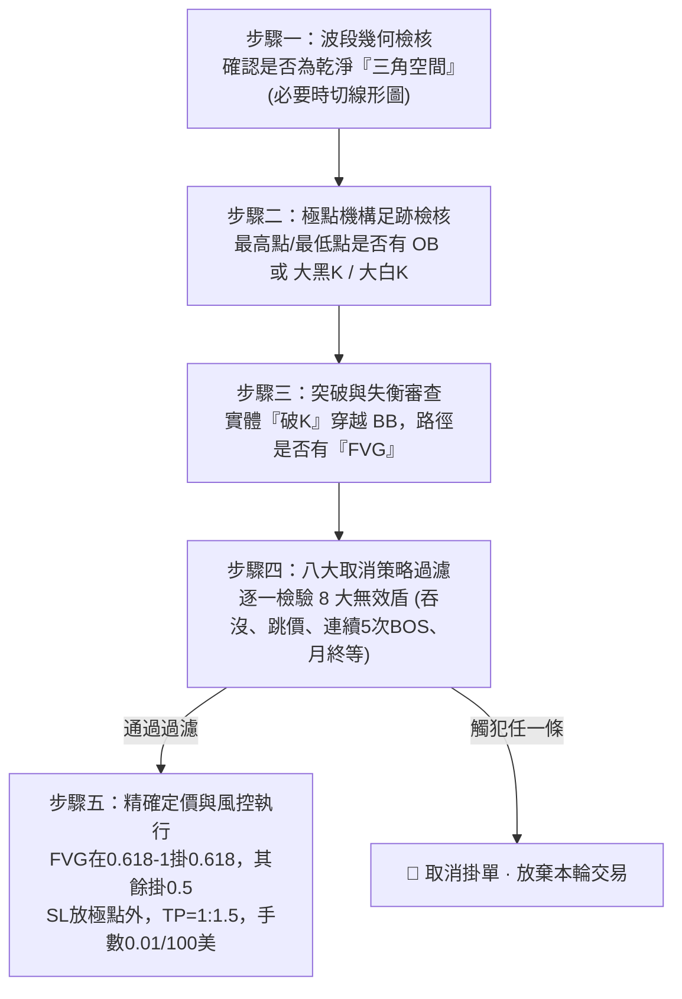

# XAUUSD 專屬頂級交易系統 · 結構策略操作手冊 (Structure Strategy)

> **版本**：1.0 官方正式版  
> **體系**：機構訂單流（SMC）· 純價格行為（Price Action）結構體系  
> **適用商品**：XAUUSD (黃金) 及主流外匯貨幣對  
> **核心概念**：三角空間 · BB · OB · 破K · COC · BOS · FVG · OTE 定價模型  

---

## 📖 系統導言：何謂「結構策略」？

本策略獨立於先前的「領域策略」，是一套專注於**機構訂單流（Smart Money Concepts / SMC）**的純幾何結構交易系統。  
本系統不依賴滯後的傳統技術指標，而是透過市場價格所留下的**流動性失衡（FVG）**、**機構足跡（OB / 大實體K）**以及**關鍵結構破位（COC / BOS）**，捕捉極致清晰且高勝率的順勢與轉折波段。

---

## 🏛️ 第一章：核心組件與名詞精確定義

在執行本策略前，必須對盤面五大關鍵元素建立毫不模糊的認知：

### 🖼️ 原理圖解：一眼看懂「V」與「倒 V」


#### 1. 【看漲多頭】＝ 乾淨俐落的「V 字型」
* **白話 4 步驟拆解**：
  1. 價格從左邊高點 **【BB】** 開始往下掉。
  2. 掉到最底部的谷底，形成 **【OB】**（若無 OB 則必須有大白K）。
  3. 價格從谷底強勢往上衝，這段衝刺路徑中要有 **【FVG 價值失衡區】**。
  4. 從左邊 BB 往右拉一條水平線（此線代表 **COC / BOS**），當上衝的 K 棒**實體穿過這條水平線**，這根 K 棒就是 **【破K】**！
  * ➔ **進場口訣**：`左高BB → 跌至OB → 衝出FVG → 破K實體穿過BB水平線 ➔ 等待回踩 0.618 / 0.5 進場做多！`

---

#### 2. 【看跌空頭】＝ 乾淨俐落的「倒 V 字型」
* **白話 4 步驟拆解**：
  1. 價格從左邊低點 **【BB】** 開始往上衝。
  2. 衝到最上方的波峰，形成 **【OB】**（若無 OB 則必須有大黑K）。
  3. 價格從波峰強勢往下砸，這段下殺路徑中要有 **【FVG 價值失衡區】**。
  4. 從左邊 BB 往右拉一條水平線（此線代表 **COC / BOS**），當下砸的 K 棒**實體跌穿這條水平線**，這根 K 棒就是 **【破K】**！
  * ➔ **進場口訣**：`左低BB → 漲至OB → 砸出FVG → 破K實體跌破BB水平線 ➔ 等待回抽 0.618 / 0.5 進場做空！`

### 1. 三角空間（Triangle Space）
* **定義**：走勢必須形成清晰、乾淨、獨立的 **V 型（多頭）** 或 **倒 V 型（空頭）** 擺動波段。
* **大師檢驗秘訣**：若 K 棒交錯難以辨識，**立即切換至「線形圖（Line Chart）」**；若線形圖呈現清楚的折線轉折波段即屬合格，若呈現黏稠橫盤鋸齒則視為無效。

### 2. BB（Base Boundary / 結構基準線）
* **多頭架構**：三角空間左側的回調起始**高點**（起跌點）。
* **空頭架構**：三角空間左側的衝高起始**低點**（起漲點）。
* **功能**：由 BB 延伸出的水平線，是判定市場結構是否發生突破的**生死臨界線**。

### 3. OB（Order Block / 訂單塊）與大實體 K
* **多頭 OB**：三角空間最低谷底處，下跌波段的最後一根實體陰線（機構吸籌區間）。
  * *替代條件*：若無標準 OB，谷底必須出現**大白K（強烈多頭大實體陽線）**。
* **空頭 OB**：三角空間最高波峰處，上漲波段的最後一根實體陽線（機構派發區間）。
  * *替代條件*：若無標準 OB，波峰必須出現**大黑K（強烈空頭大實體陰線）**。

### 4. 破K（Breakout Candle）
* 自 OB / 極值點反轉後，強勢推升/下殺，並以**「實體收盤價（Body Close）」**正式穿越 BB 水平線的第一根 K 棒。
* 破位瞬間標註為 **COC（性質轉變）** 或 **BOS（結構突破）**。

### 5. FVG（Fair Value Gap / 價值失衡區）
* 位於極值點（OB / 大K）至「破K」的推進波段中，由連續三根 K 棒所形成的**未重疊價格跳空區間**（第 1 根引線與第 3 根引線之間留下的單邊失衡空隙）。
* FVG 代表大資金急迫推升/下殺時所遺留的未成交籌碼，是後續價格回調（Mitigation）的最強引力區。

---

## 🎯 第二章：進場基本條件（四大標準型態）


盤面必須**完全符合**以下四種幾何形態之一，方可成立進場觀察名單：

| 型態分類 | 起始 BB | 極值處要求 (底/頂) | 推進路徑要求 | 破位要求 | 備註說明 |
| :--- | :--- | :--- | :--- | :--- | :--- |
| **① 多頭標準 OB 形態** | 左側高點 | 最低點具備標準 **OB** | 途中伴隨 **FVG** | **破K** 實體穿過 BB | 最經典機構吸籌轉折 |
| **② 空頭標準 OB 形態** | 左側低點 | 最高點具備標準 **OB** | 途中伴隨 **FVG** | **破K** 實體穿過 BB | 最經典機構派發轉折 |
| **③ 多頭大白K 形態** | 左側高點 | 無 OB，但最低點有**大白K** | 途中伴隨 **FVG** | **破K** 實體穿過 BB | 巨幅動能反彈推升 |
| **④ 空頭大黑K 形態** | 左側低點 | 無 OB，但最高點有**大黑K** | 途中伴隨 **FVG** | **破K** 實體穿過 BB | 巨幅動能下殺貫穿 |

### 💡 FVG 核心特許條款（重要細節）：
1. **COC（性質轉變）可以無 FVG**：初生反轉動能爆發時若無失衡區，仍屬有效。
2. **其它條件不佳下，若有 FVG 則保留評估資格**：
   * 當 BB 形態為「十字震盪 K」或「反轉 K」時。
   * 當 BB 與 OB 價位重複出現時。
   * 當 OB 與 BB 價位重複，且 OB 波動小於 BB 時。
   * 只有 COC 且無 FVG 時。  
   *(以上四種偏向雜亂之瑕疵盤面，若路徑中浮現明確的優質 FVG，則破例重獲評估進場資格！)*

---

## 🛡️ 第三章：八大取消策略（無效防護盾 · 一票否決制）


任何結構訊號只要觸犯以下 8 種情況之一，**立即取消掛單與交易策略，嚴禁出手**：

```
┌─────────────────────────────────────────────────────────────────┐
│                    ★ 八大取消策略檢核清單 ★                     │
├─────────────────────────────────────────────────────────────────┤
│ [ ] 1. 非三角空間 (橫向搓揉、缺乏乾淨折線，可切線形圖確認)      │
│ [ ] 2. 無 OB (三角空間最高無大黑K，或最低無大白K)                │
│ [ ] 3. 破位K以及下一根K為反向吞沒組合 (典型假突破獵殺陷阱)       │
│ [ ] 4. 當月裡前面有反向大實體K形成的 FVG (前方遇重大未緩解阻礙) │
│ [ ] 5. 月底收盤取消前面所有結構訊號策略 (月末調倉盤面重置)       │
│ [ ] 6. 續漲 BOS 低於看漲 COC，或 續跌 BOS 高於看跌 COC          │
│ [ ] 7. 漲跌訊號皆有則先進漲就剛跌，反之亦是 (箱體橫盤來回掃)     │
│ [ ] 8. BOS 連續 5 次 (趨勢第 5 浪極限衰竭，防範暴力均值回歸)    │
└─────────────────────────────────────────────────────────────────┘
```

### 逐條機構原理解析：
* **第 1 條【非三角空間】**：缺乏乾淨的波段代表流動性尚未被單向吸收，處於散戶籌碼泥淖，勝率極低。
* **第 2 條【無 OB / 無大實體K】**：極點缺乏大資金介入痕跡，代表僅是散戶弱勢反彈，容易隨時破位。
* **第 3 條【破位K + 次根反向吞沒】**：市場主力故意以實體刺破吸引追單，次根立刻反手吞沒，此為標準「流動性獵殺（Liquidity Trap）」，趨勢將瞬間向反方向崩潰。
* **第 4 條【前方有反向大實體K FVG】**：當月走勢前面若有巨大未緩解的相反方向 FVG，該處沉澱著巨額反向限價單，進場極易在該處撞牆逆轉。
* **第 5 條【月底收盤全數取消】**：月末最後一個交易日，全球機構進行月度資產再平衡（Month-end Rebalancing），結構容易失真洗盤，一律清空過往結構。
* **第 6 條【BOS 與 COC 位置倒退】**：正常趨勢推進中，續漲 BOS 必須高於前一個 COC；若續漲 BOS 竟然低於看漲 COC，代表市場產生嚴重的「空間倒退與動能背離」，趨勢結構已壞。
* **第 7 條【橫盤雙向訊號】**：在箱體震盪盤中，多空訊號同時具備時，先觸發多單往往剛好打到頂部反轉做空，來回雙巴，必須全部放棄。
* **第 8 條【BOS 連續 5 次】**：趨勢延續超過 5 次 BOS 後，屬於極度過度延伸（Over-extended），盈虧比與續航力嚴重透支，禁止順勢追單。

---

## 💰 第四章：進場定價、掛單與風控執行手冊


### 1. 進場手數與資金管理（鐵律）
* **標準配置**：**`0.01 手 / 對應 100 美元本金`**
  * 100 USD ➔ 0.01 手
  * 500 USD ➔ 0.05 手
  * 1,000 USD ➔ 0.10 手
  * 嚴格禁止超額槓桿，確保任何單筆虧損均在帳戶安全承受範圍內。

### 2. 精確進場點位（OTE 斐波那契回調模型）
當破K確立後，**嚴禁市價追單**！必須在路徑中的 FVG 區間內掛限價單（Limit Order）：
* **情境 A（深水失衡區間）**：
  * 當 FVG 落在整段波段的 **`0.618 ~ 1.0`** 折價/溢價區間內時，**進場掛單價位精確設於 `0.618`**。
* **情境 B（中軸均衡區間）**：
  * 其餘所有情況，**進場掛單價位精確設於 `0.50 (Equilibrium)`**。

### 3. 止損 (SL) 與止盈 (TP) 設置標準
* **止損放置點 (SL)**：
  * 多頭單：放置於谷底 **OB / 大白K 低點下方**（外加 1~2 點點差緩衝）。
  * 空頭單：放置於波峰 **OB / 大黑K 高點上方**（外加 1~2 點點差緩衝）。
* **止盈放置點 (TP)**：
  * **嚴格執行固定盈虧比 `止損 : 止盈 = 1 : 1.5`**。
  * 點數公式：$TP\text{ 空間} = SL\text{ 點數} \times 1.5$。

### 4. 進場後動態持倉管理（保本守則）
* **觸發條件**：訂單成交進場後，若盤面在反向方向**新誕生了反向結構訊號**。
* **應對動作**：**立即將該筆交易的 TP 修改為進場價格（設置保本）**，保證本單零風險！
* **例外排除**：若該反向結構屬於「續漲 BOS 低於看漲 COC」或「續跌 BOS 高於看跌 COC」之畸形無效訊號，則**忽略不計，不改為保本**，維持原定 TP。

### 5. 跳價（Gap）禁令
* **盤面出現跳空（Gap）**：**立即取消一切 OTE 掛單**。
* **核心鐵律**：在該跳價缺口尚未完全回補之前，**嚴格禁止進場任何與跳價同方向的單子**（防範假突破與缺口反吸）。

### 6. 新舊 OB 競爭法則
* 當行情發展出一個「新 OB」，而該新 OB 在推動過程中**打穿了前方的「舊 OB」**：
* **評估判定**：該新 OB 的勝率大幅衰減，後續回踩此新 OB 時需極度保守或放棄操作。

---

## 📋 第五章：交易員每日 5 步驟標準作戰流程



1. **步驟一｜波段幾何檢核**：確認圖表形成清楚的三角空間（V型 / 倒V型），線形圖折線分明。
2. **步驟二｜極點足跡檢核**：谷底是否有 OB / 大白K，或波峰是否有 OB / 大黑K。
3. **步驟三｜突破與失衡審查**：破K實體收盤穿越 BB，路徑中確認 FVG 存在（COC 遇盤整瑕疵需有 FVG 才能評估）。
4. **步驟四｜八大取消盾檢驗**：逐條核對 8 大取消條件，只要符合任一條立即放棄。
5. **步驟五｜精確掛單與執行**：
   - 測量回調位置：FVG 在 0.618~1 掛 0.618，其餘掛 0.5。
   - 嚴格設置 SL 於極值點外，TP 依 1:1.5 比例設定。
   - 依 0.01 手 / 100 美元嚴格控制倉位，進場後若遇反向結構立刻保本！

---

## 🛡️ 大師總結：結構策略的心法鐵律
1. **不急躁追價**：破K 只代表結構確立，所有的獲利空間皆來自於「等待回踩 OTE（0.618 / 0.5）」。
2. **無三角不交易**：震盪與雜訊是虧損的根源，只做線形圖一眼能看出的乾淨三角。
3. **嚴守八大盾**：高手的差異不在於進場次數，而在於能否靠 8 大取消策略避開致命的誘捕盤。
