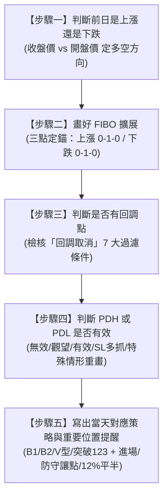

# 🔱 XAUUSD 專屬領域交易系統：完善操作手冊
> **系統核心定位**：全客觀定錨 × 幾何分位拍賣 × 流動性獵殺 × 鐵血持倉風控  
> **每日最高執行標準**：**「五步操盤流水線 SOP」**

---

## 🧭 系統總綱：每日五步操盤流水線 (5-Step Daily Pipeline)

您的系統每天早晨開盤（06:00 夏令 / 07:00 冬令）的完整標準作業流程如下：



---

## 📑 目錄
1. [步驟一：前日多空定性判斷](#步驟一前日多空定性判斷)
2. [步驟二：三點 FIBO 擴展精準定錨 (圖式說明)](#步驟二三點-fibo-擴展精準定錨-圖式說明)
3. [步驟三：回調點有效性檢驗 (有無回調 / 回調取消)](#步驟三回調點有效性檢驗-有無回調--回調取消)
4. [步驟四：PDH / PDL 狀態與有效性判定 (含特殊情形重畫)](#步驟四pdh--pdl-狀態與有效性判定-含特殊情形重畫)
5. [步驟五：產出當日對應策略與重要位置提醒 (實戰範本)](#步驟五產出當日對應策略與重要位置提醒-實戰範本)
6. [回測驗證風控鐵律 (首探不破 / 讓100~200點 / 12%平半)](#回測驗證風控鐵律)

---

## 步驟一：前日多空定性判斷

每天換日後的第一件事，是客觀定性昨日的 K 棒屬性：
* **前日上漲（多頭主導）**：前日收盤價 $\ge$ 前日開盤價（日線為陽棒）。
* **前日下跌（空頭主導）**：前日收盤價 $<$ 前日開盤價（日線為陰棒）。
* **特別注意**：
  * 若前一日未破前天的 PDH 和 PDL 則需搭配 TL 並觀望且標註「震盪收縮日」。
  * 若前一日為「極端急漲 / 急跌」，標註為「漲/跌動能過激日」。

---

## 步驟二：三點 FIBO 擴展精準定錨 (圖式說明)

依據步驟一的定性結果，執行無主觀偏差的三點斐波那契擴展繪製：

### 🎯 七大核心功能區劃分 (完美對稱架構)
* **1 ~ 1.05 之間**：**注意假突破區**
* **0.9 ~ 1 之間**：**領域未破區**
* **0.7 ~ 0.9 之間**：**轉折區 (注意 0.786)**
* **0.3 ~ 0.7 之間**：**震盪觀望區**
* **0.1 ~ 0.3 之間**：**轉折區 (注意 0.214)**
* **0 ~ 0.1 之間**：**領域未破區**
* **-0.05 ~ 0 之間**：**注意假突破區**

---

### 1. 前日上漲（看多擴展拉法與示意圖）
* **第一點**：前日最低點 $\rightarrow$ **FIBO 0 (PDL)**
* **第二點**：前日最高點 $\rightarrow$ **FIBO 1 (PDH)**
* **第三點**：再回到前日最低點 $\rightarrow$ **FIBO 0 (PDL)**

```
【前日上漲：看多回踩擴展示意圖】

─── 1.05 ──────────────────────────────────────────
      │  ★【1 ~ 1.05 之間為注意假突破區】
─── 1.00 (PDH) ────────────────────────────────────
      │  ★【0.9 ~ 1 之間為領域未破區】
─── 0.90 ──────────────────────────────────────────
      │  ★【0.7 ~ 0.9 之間為轉折區 (注意 0.786)】
─── 0.786 ─────────────────────────────────────────
      │
─── 0.70 ──────────────────────────────────────────
      │  ★【0.3 ~ 0.7 之間為震盪觀望區】
─── 0.30 ──────────────────────────────────────────
      │  
─── 0.214 ─────────────────────────────────────────
      │  ★【0.1 ~ 0.3 之間為轉折區 (注意 0.214)】
─── 0.10 ──────────────────────────────────────────
      │  ★【0 ~ 0.1 之間為領域未破區】
─── 0.00 (PDL) ────────────────────────────────────
      │  ★【-0.05 ~ 0 之間為注意假突破區】
─── -0.05 ─────────────────────────────────────────
```

---

### 2. 前日下跌（看空擴展拉法與示意圖）
* **第一點**：前日最高點 $\rightarrow$ **FIBO 0 (PDH)**
* **第二點**：前日最低點 $\rightarrow$ **FIBO 1 (PDL)**
* **第三點**：再回到前日最高點 $\rightarrow$ **FIBO 0 (PDH)**

```
【前日下跌：看空反彈擴展示意圖】

─── -0.05 ─────────────────────────────────────────
      │  ★【-0.05 ~ 0 之間為注意假突破區】
─── 0.00 (PDH) ────────────────────────────────────
      │  ★【0 ~ 0.1 之間為領域未破區】
─── 0.10 ──────────────────────────────────────────
      │  ★【0.1 ~ 0.3 之間為轉折區 (注意 0.214)】
─── 0.214 ─────────────────────────────────────────
      │
─── 0.30 ──────────────────────────────────────────
      │  ★【0.3 ~ 0.7 之間為震盪觀望區】
─── 0.70 ──────────────────────────────────────────
      │
─── 0.786 ─────────────────────────────────────────
      │  ★【0.7 ~ 0.9 之間為轉折區 (注意 0.786)】
─── 0.90 ──────────────────────────────────────────
      │  ★【0.9 ~ 1 之間為領域未破區】
─── 1.00 (PDL) ────────────────────────────────────
      │  ★【1 ~ 1.05 之間為注意假突破區】
─── 1.05 ──────────────────────────────────────────
```

---

## 步驟三：回調點有效性檢驗 (有無回調 / 回調取消)

> **🔴 操作鐵律**：  
> **「使用回調點進場前需觀望且配合 TL 或盤勢轉換」**  
> *（不可僅憑價格觸碰就盲目左側摸底，必須等待趨勢線 TL 突破/回踩，或配合歐美盤勢轉換切點確認動能轉換！）*

在尋找進場前，必須先嚴格過濾「回調取消」的 7 大無效情境：

### 📋 回調取消 7 大無效情境細則
1. **若回調點是前一日的 H1 倒數三根 K 棒則取消**
2. **回調在領域內**
3. **PDH 或當日出現反轉空或開盤下跳則取消回調低（易下破）**
4. **PDL 或當日出現反轉多或開盤上跳則取消回調高（易上破）**
5. **前一日急跌則取消回調低（易下破）**
6. **前一日急漲則取消回調高（易上破）**
7. **前一日未破前天的 PDH 和 PDL**

### ⚔️ 進場觸發鐵律深度解析：
* **配合 TL（趨勢線 Trend Line）**：當價格來到回調點時，切到 M15/M5 畫出短期修正趨勢線，**必須等待價格實體突破 TL 或回踩 TL 確認支撐/阻力成立**，方可出手。
* **配合盤勢轉換（Session Transition）**：結合四大盤勢切換關鍵節點（**14:00 歐盤開盤、18:00 美盤前段數據期、22:00 美盤後段趨勢期**），在資金交接、流動性注入時確認動能，避免在亞盤死水期提早進場承受無效浮虧與時間磨損。

---

## 步驟四：PDH / PDL 狀態與有效性判定 (含特殊情形重畫)

回調確定有效後，進入當日最關鍵的邊界狀態判定：

### 1. PDH / PDL 無效與取代判定
1. **提早休市或來回三段（SL 要多抓且手數需保守）**：
   * **「提早休市」**：意指前一天 H1 K 棒未滿 23 根。
   * **「來回三段」**：意指有突破 PDH 或 PDL 的來回掃盤。
   * **取代防守基準**：改用**前天 PDH 和 PDL** 或 **當日亞盤的收盤高低點**做防守基準。
2. **跳價需等回補後再操作同向單**：
   * 若未回補則無回調點相關可使用。
3. **前一天 H1 關盤淺回至 0.9 ~ 1**：
   * 多頭/空頭動能極強，注意假突破區或當日的回調。
4. **前一天 H1 關盤的 K 棒剛好是 PDH / PDL**：
   * 注意假突破區或當日的回調。
5. **前一天 H1 關盤在 0.3 ~ 0.7**：
   * 嚴格觀望至亞盤 END 後可搭配 TL。

---

### 2. PDH / PDL 觀望或有效判定 (跳價需觀望)
① 前一天下跌 + H1 關盤在 0.1 ~ 0.3 (0.214) 且 PDL 為反轉（上跳取消或等亞盤 END）  
② 前一天上漲 + H1 關盤在 0.1 ~ 0.3 (0.214) 且 PDH 為反轉（下跳取消或等亞盤 END）  
③ 前一天下跌 + H1 關盤在 0.7 ~ 0.9 (0.786) 且 PDL 為反轉（下跳取消或等亞盤 END）  
④ 前一天上漲 + H1 關盤在 0.7 ~ 0.9 (0.786) 且 PDH 為反轉（上跳取消或等亞盤 END）  
⑤ 前一天急跌則 PDL 觀望  
⑥ 前一天急漲則 PDH 觀望  
⑦ 前一天下跌 + H1 關盤在 0 ~ 0.1 則領域失效（等亞盤 END）  
⑧ 前一天上漲 + H1 關盤在 0 ~ 0.1 則領域失效（等亞盤 END）  

---

### 3. 特殊情形
① **破 PDH/PDL 後出現反轉K或收回領域內** ➔ 【重畫領域 (逆勢注意保本)】  
② **破 PDH/PDL 後收回轉折區內** ➔ 【可等回調領域 (逆勢注意保本)】  
③ **不破 PDH/PDL (非反轉K) 先回調再破** ➔ 【可用當日回調 (若破 PDH/PDL 後出現反轉K或收回領域內則取消)】  
④ **強趨勢破 PDH/PDL (回調點相關不使用)** ➔ 【可搭配 TL】  

---

## 步驟五：產出當日對應策略與重要位置提醒 (實戰範本)

完成前四步分析後，每天早晨產出專屬的**「每日作戰日誌」**：

### 📋 當日作戰日誌標準範本 (Template)
```markdown
【日期】：2026-XX-XX
【步驟一：前日定性】：前日上漲 / 前日下跌 / [標註：震盪收縮日(需搭配TL並觀望) / 漲動能過激日 / 跌動能過激日]

【步驟二：波幅數據】：
  * 昨日波幅：XXXX
  * 前五日平均波幅：XXXX

【步驟三：回調點判定】：
  * 是否回調：[是 / 否]
  * 收盤區域在哪：[例如：0.7~0.9 / 0.3~0.7 / 0.1~0.3 / 領域內 0~0.1 等]
  * 是否上跳或下跳：[正常無跳價 / 開盤上跳 / 開盤下跳]
  * 使用前天 PDH 和 PDL：[是 / 否]

【步驟四：PDH / PDL 有效性】：
  * 判定結果：[有效 / 觀望 / SL要多抓 / 領域失效(等亞盤END) / 重畫領域]

【步驟五：當日策略】：
  * 今日策略：[寫出今日用此系統什麼策略即可]
```

---

## 回測驗證風控鐵律

1. 拒絕在同一個盤勢裡多次試單。
2. 獲利為止損兩倍時可平倉一半，是否做保本看進場位置是否容易被掃掉。
3. 若止損要更多，則手數需更加保守。
